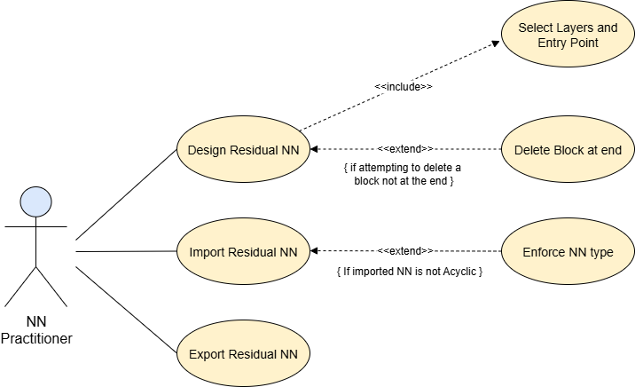
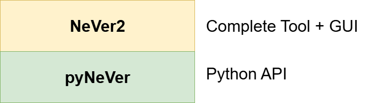
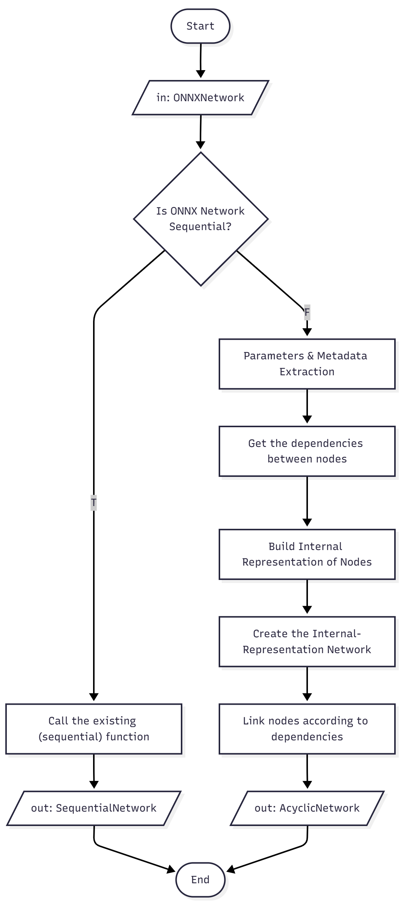
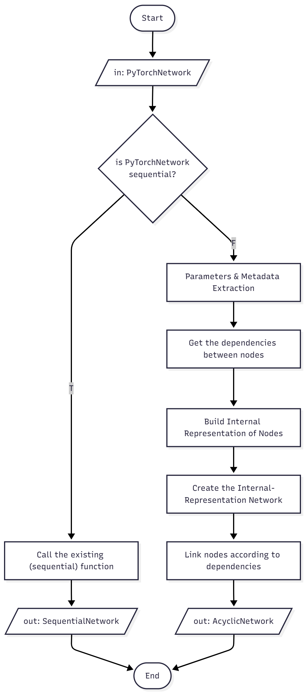
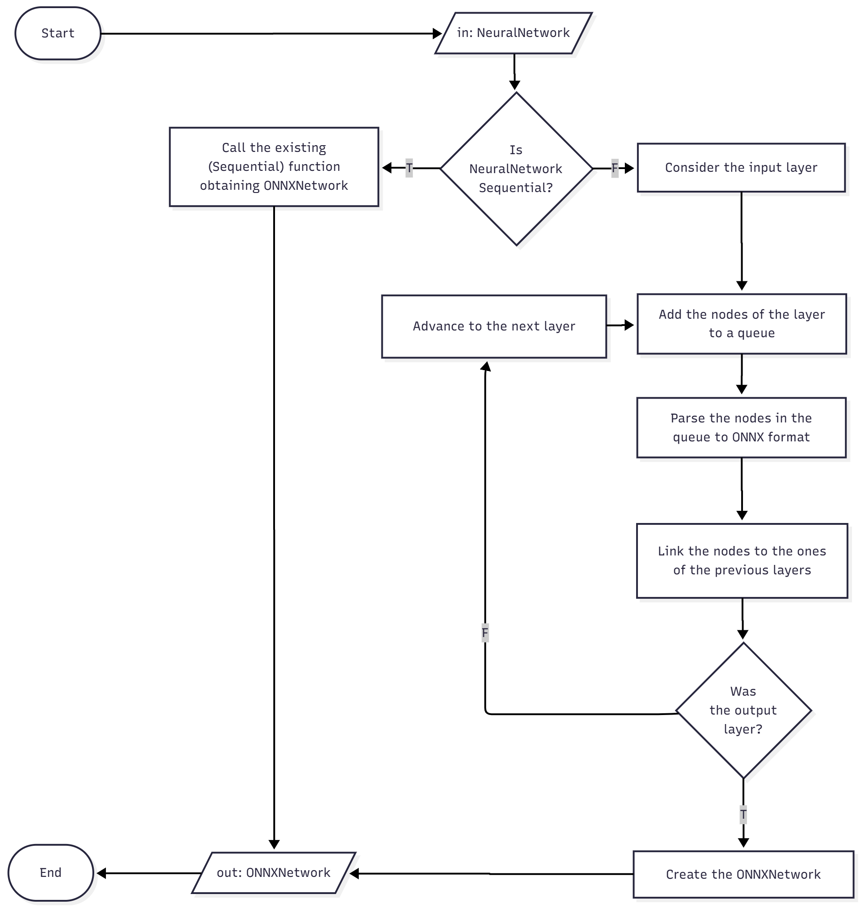
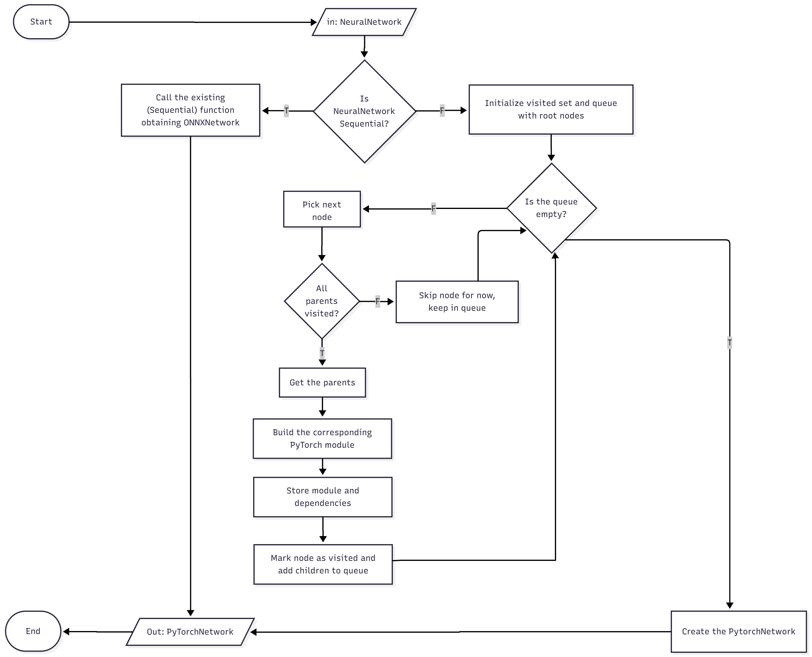
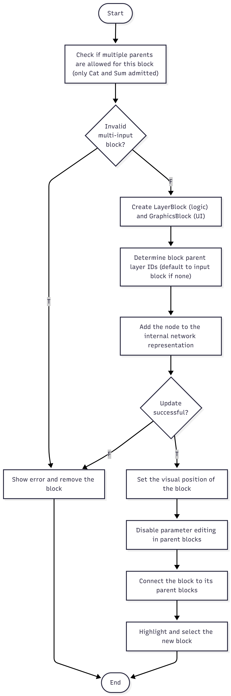
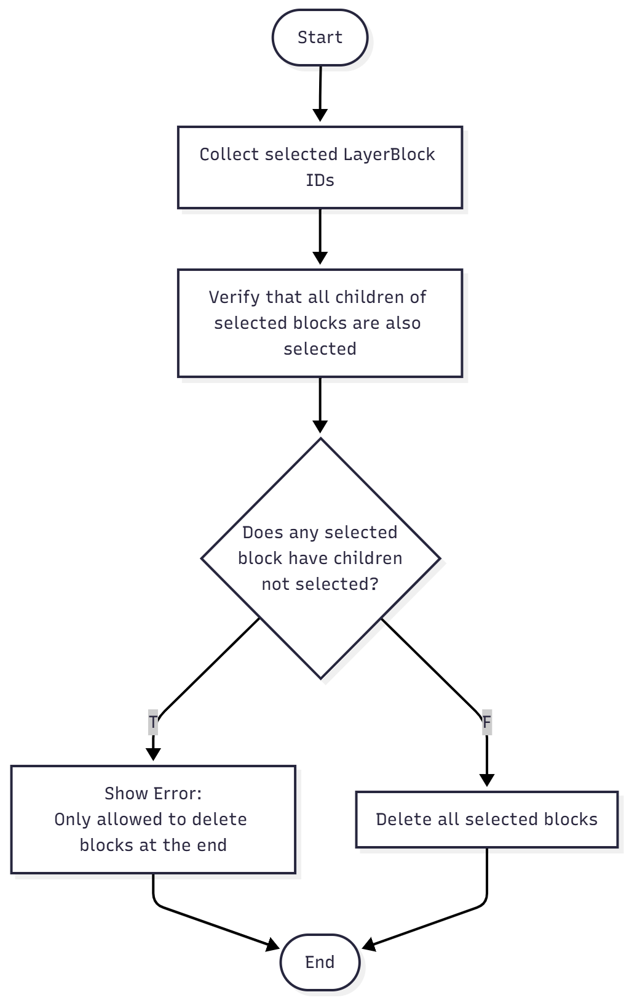
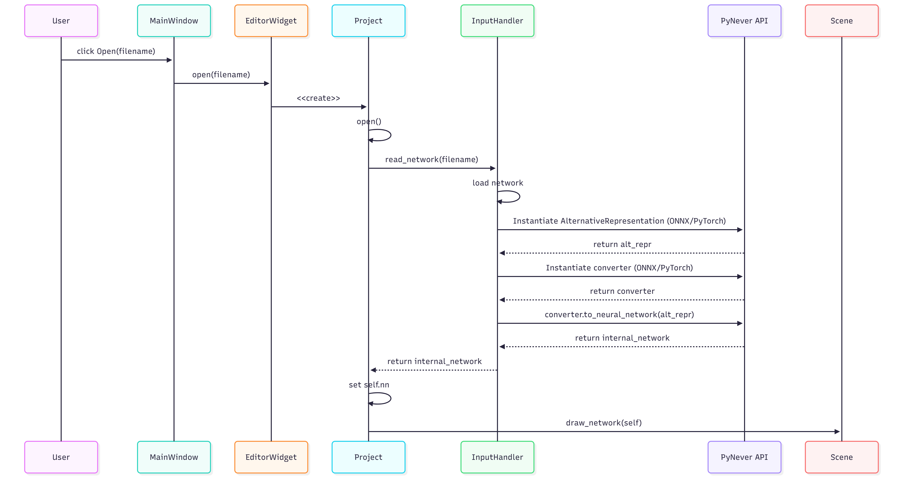
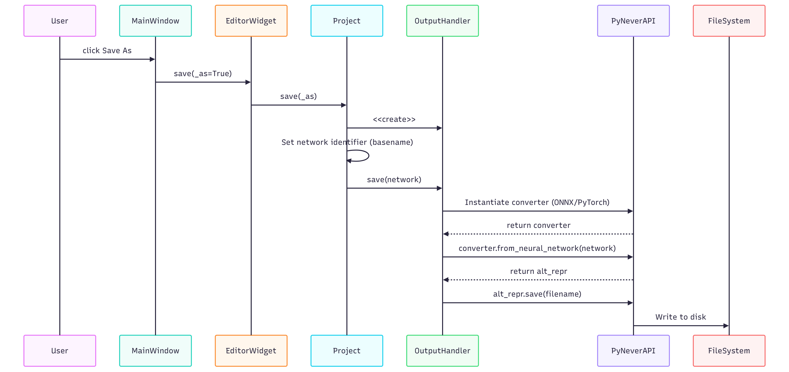

# ResNet integration in NeVer2

## Design Requirement Specification Document

DIBRIS – Università di Genova. Scuola Politecnica, Software Engineering Course 80154

 <b> Authors </b>   Andrea Valentino Ricotti   Azzurra Suffia 

### REVISION HISTORY

Version | Date | Author(s)| Notes
---------|------|:--------:|------
1.0 | 2025/09/23 | Andrea Valentino Ricotti   Azzurra Suffia | First version of the document.
2.0 | 2025/11/19 | Andrea Valentino Ricotti   Azzurra Suffia | Added sequence and activity diagrams.

## Table of Content

1. [Introduction](#intro)
    1. [Purpose and Scope](#purpose)  
    2. [Definitions](#def)
    3. [Document Overview](#overview)
    4. [Bibliography](#biblio)
2. [Project Description](#description)
    1. [Project Introduction](#project-intro)
    2. [Technologies used](#tech)
    3. [Assumptions and Constraints](#constraints)
3. [System Overview](#system-overview)
    1. [System Architecture](#architecture)
    2. [System Interfaces](#interfaces)
    3. [System Data](#data)
        1. [System Inputs](#inputs)
        2. [System Outputs](#outputs)
4. [API (pyNeVer)](#sys-module-1)
    1. [Structural Diagrams](#sd-sm1)
    2. [Dynamic Models](#dm-sm1)
       1. [Activity Diagrams](#at-sm1)
5. [GUI (NeVer2)](#sys-module-2)
    1. [Structural Diagrams](#sd-sm2)
    2. [Dynamic Models](#dm-sm2)
       1. [Activity Diagrams](#at-sm2)
       2. [Sequence Diagrams](#sq-sm2)
       

##    1 Introduction

    
 The Design Specification Document (DRS) reflects the design and provides directions to the builders and coders of the product.
 
This document captures the system design and provides guidance to builders and developers for implementation. It serves as a communication tool between designers and implementers, ensuring the intended design is correctly understood and followed. Design models are developed and evaluated prior to system implementation to ensure correctness and alignment with requirements. The document describes how the design satisfies both functional and non-functional requirements, detailing architectural structure, module interactions, and data flows. It provides clear structural and behavioral specifications to support consistent development and verification.

    
###  1.1 Purpose and Scope

    
This section presents the purpose of the DRS (i.e., to define and communicate the system design) and identifies its intended audience, including developers, designers, testers, internal stakeholders, and future maintainers.

   
The purpose of the DRS is to define and communicate the system design, providing clear guidance to developers, designers, and stakeholders. It ensures that the system is implemented according to the intended design and meets all functional and non-functional requirements.

This DRS focuses on the integration of Residual Neural Networks (ResNets) in NeVer2. The tool is designed to be extensible to support additional neural network architectures, and this document outlines the design solutions that will be implemented to achieve this goal.

    
The intended audience of this document includes the following groups:

    <ul>
        <li><strong>Developers / Coders / Builders:</strong> Implement the system according to the specifications and rely on the DRS to understand architecture, module interactions, and data flows.</li>
        <li><strong>Designers / System Architects:</strong> Ensure the design intent is properly documented and communicated, and verify alignment with requirements.</li>
        <li><strong>Testers:</strong> Plan tests, verify functionality, and ensure compliance with requirements.</li>
        <li><strong>Stakeholders:</strong> Track progress, understand system functionality, and ensure requirements are addressed.</li>
        <li><strong>Future Maintainers:</strong> Consult the DRS to understand the system design for updates, maintenance, or extensions.</li>
    </ul>

###  1.2 Definitions

 
    

This subsection defines the key acronyms and terms used throughout this document, including fundamental neural network concepts such as NN (Neural Network) and RNN (Residual Neural Network).

The following table lists the definitions of terms and acronyms referenced in this document to ensure clarity and consistency during the project development.

| Acronym | Definition |
|---------|------------|
| NN      | Neural Network |
| RNN     | Residual Neural Network |
    

###  1.3 Document Overview

 
    
This document is organized into five main sections: <b>Introduction</b>, <b>Project Description</b>, <b>System Overview</b>, and the two modules that compose the system, <b>pyNeVer</b> and <b>NeVer2</b>.
    
 
    
  

1. **Introduction**  
   This section defines the role of the Design Requirements Specification (DRS), outlining its purpose and principal components.  

2. **Project Description**  
   This section specifies the overall objectives of the project, the technologies selected for implementation, and the assumptions and constraints that guide the system design.  

3. **System Overview**  
   This section describes the system as a whole, including its architecture, external interfaces, managed data, and expected inputs and outputs.  

4. **API (pyNeVer)**  
   This section presents the API module. In this section, the designed extensions are represented through behavioral diagrams to illustrate their integration and functionality.  

5. **GUI (NeVer2)**  
   This section presents the complete tool and describes the improvements made to its graphical user interface (GUI). The design is documented through behavioral diagrams, covering dynamic aspects of the enhancements, similar to the approach used for pyNeVer.

###  1.4 Bibliography

 
    

This section lists the key references used in the preparation of this project, comprising a research article [1] and a doctoral thesis [2].

 

[1] S. Demarchi, D. Guidotti, L. Pulina, and A. Tacchella, 
<a href="../ref/NeVer2_learning_and_verification_of_neural_network.pdf"><em>NeVer2: Learning and Verification of Neural Networks</em></a>, 2023.

[2] S. Demarchi, 
<a href="../ref/Experimenting_with_Constraint_Programming_Technique_in_AI.pdf"><em>Experimenting with Constraint Programming Techniques in Artificial Intelligence: Automated System Design and Verification of Neural Networks</em></a>, 2023.

##  2 Project Description

###  2.1 Project Introduction

 
 
This section provides a high-level overview of the project’s main challenge—extending NeVer2 to support ResNets beyond its current sequential (Feedforward) limitation—and the proposed solution of integrating them while enabling layers to have multiple parents or children.

    
The goal of this project is to incorporate a new neural network architecture, specifically Residual Neural Networks (ResNets), into NeVer2, focusing on import, export, and network design. At present, the tool is limited to Sequential (Feedforward) networks, constituting its main constraint. To overcome this limitation, the solution involves extending the tool to handle a broader class of networks, specifically Acyclic networks that encompass ResNets. This extension will allow layers to have multiple parents or children while respecting the network’s structural rules, and ensures proper handling during import, design, and export.

    
No node can currently accept multiple children, which is not a theoretical limitation but a software constraint stemming from the system’s assumption of sequential networks. Consequently, whenever a network is defined, created, or manipulated, this assumption must be overcome to properly handle non-sequential networks.

    
For importing, the main challenge is detecting acyclic networks and distinguishing them from sequential ones, as the two are currently handled by separate routines. This will eventually be achieved by exploring the network structure and tracking the relationships among layers; if at least one layer has multiple parents or children, the network will be recognized as acyclic.

    
In the GUI, networks are currently designed by sequentially adding nodes one by one from input to output. To support ResNets, users shall be allowed to open new branches. 

    
For exporting, the conversion mechanism will be improved to support general acyclic structures, rather than assuming a sequential layout.

    
The detailed design solutions are presented in sections <a href="#sys-module-1">PyNeVer</a> and <a href="#sys-module-2">NeVer2</a>. These extensions will enable NeVer2 to support a broader range of neural network architectures, providing users with more flexible design.

    

###  2.2 Technologies used

    
This section summarizes the technologies and tools used to implement the extension.

     
    
The system is implemented in Python and incorporates deep learning frameworks and standards to support maintainability, scalability, and interoperability. The following tools and frameworks are employed:

    <ul>
        <li><strong>Programming Language:</strong> Python</li>
        <li><strong>IDE / Development Tools:</strong> Visual Studio Code, GitHub </li>
        <li><strong>Deep Learning Frameworks:</strong> PyTorch, ONNX</li>
        <li><strong>GUI Framework:</strong> PyQt</li>
    </ul>
    
These technologies have been used in the development of the original tool and will continue to be employed in the extension.

###  2.3 Assumption and Constraint 

 
    
 This section outlines the assumptions made during the project design, such as supported neural network layers and tool dependencies, as well as the constraints that may limit the implementation, including technical limitations, performance considerations, and compatibility requirements. 

     

<b>Assumptions</b>

<ul>
    <li> Users are familiar with basic neural network concepts.</li>
    <li>Users are expected to interact with the system primarily through the <b>NeVer2 GUI</b>.</li>
    <li>The computing environment will support standard deep learning libraries (<b>PyTorch, ONNX</b>) without requiring custom hardware beyond a standard CPU/GPU setup.</li>
</ul>

<b>Constraints</b>

<ul>
    <li>Only <b>ONNX</b> and <b>PyTorch</b> file formats are supported for importing and exporting networks.</li>
    <li>Only the specified layers and activation functions will be supported.</li>
    <li>Only <b>one network at a time</b> can be imported or exported; importing a new network while another is displayed will overwrite the existing one.</li>
</ul>

##   3 System Overview

 
    
Overview of system modules and use cases.

     
    

    The system consists of two main modules: (1) the backend API module (<b>pyNeVer</b>), and (2) the frontend GUI module (<b>NeVer2</b>). 
    These modules interact to provide the complete functionality of the tool. Since NeVer2 integrates the PyNeVer API, we consider NeVer2 as the complete system in this document. Throughout this section, except when discussing system interfaces, PyNeVer is treated as an internal component of NeVer2 rather than as a separate entity.
    

    

    This section presents the system's Use Case Model relative to NeVer2. The main use cases include:
    

    <ul>
        <li>Extending the existing <b>Import NN</b> use case to support the import of new neural network architectures, specifically ResNets.</li>
        <li>Extending the existing <b>Export NN</b> use case to support the export of new neural network architectures, specifically ResNets.</li>
        <li>Extending the <b>Design NN</b> use case to support the design of new neural network architectures, specifically ResNets.</li>
    </ul>
    

    
    

###   3.1 System Architecture

 

Overview of the system architecture, highlighting NeVer2 as the complete tool with a GUI frontend and pyNeVer as the modular backend API responsible for network operations.

A graphical representation of the system architecture is shown below. 
 

<b>pyNeVer</b> serves as the backend for <b>NeVer2</b> and is designed as a modular API for managing deep neural networks. It supports tasks ranging from network construction and training to verification, and is organized into seven packages, each focused on either providing neural network models or implementing strategies for their conversion, training, and verification. <b>NeVer2</b> delegates all network operations—including creation, layer management, format conversion, and verification—to the PyNeVer API. The GUI translates user interactions into function calls to PyNeVer classes and methods, and receives results and updated network objects for visualization and further manipulation. This internal interface ensures a clear separation between the frontend and the computational backend, allowing NeVer2 to provide a graphical environment without directly implementing neural network logic.

###   3.2 System Interfaces

 
    
 NeVer2 provides multiple system interfaces: an external graphical interface intended for end users, an internal interface between the NeVer2 tool and the PyNeVer API, an interface between the API and the PyTorch framework, used for model representation and training, and an import/export interface supporting interoperability with external frameworks through PyTorch (<code>.pt</code>, <code>.pth</code>) and ONNX (<code>.onnx</code>) formats. 
    

     
<b>NeVer2 GUI:</b>

The NeVer2 graphical interface provides an external environment for 
defining, visualizing, and manipulating neural networks. This interface is already implemented in the tool, and developed using the <b>PyQt6</b> graphical library. It is organized around a <b>canvas</b>, with sidebars for layer selection and detailed information. In the canvas, input and output blocks define the network boundaries.

Currently, when the user clicks a button in the layer toolbar, the new layer is always added at the end of the layer sequence, regardless of which layer is currently selected. This behavior must be modified to allow users to open and close branches.  
The new interaction model should work as follows:
<ul>
    <li>The user first selects the layer to which they want to add a child on the canvas.</li>
    <li>Then, they click the desired layer type in the toolbar to add it as a child.</li>
    <li>If the new layer is the first child of the selected layer, the behavior remains unchanged.</li>
    <li>If the selected layer already has children, a new branch is automatically created.</li>
</ul>
After insertion, the newly added layer becomes the active (selected) layer. Otherwise, the selection would remain on the originally selected layer, which would make adding multiple layers in sequence cumbersome. This behavior allows users to add multiple cascading layers by repeatedly clicking items in the toolbar, without having to reselect the last inserted layer each time. 
To close a branch using one of the merge layers, the user simply selects all the layers whose outputs must converge into a single layer. This can be done via Ctrl + click or by selecting the area containing the desired layers.

 Training and verification remain unchanged and are accessible via the <b>menu bar</b>. 

<b>PyNeVer–NeVer2 Interface:</b>

NeVer2 delegates network operations (creation, layer management, import/export, verification) 
to the <b>PyNeVer API</b>. The GUI translates user interactions into function calls, while results 
are returned for visualization and further manipulation. For this project, the interface will be extended to accommodate the handling of additional neural network architectures.

<b>Import/Export Interfaces:</b>

The system supports interoperability with external tools through <b>PyTorch</b> 
(<code>.pt</code>, <code>.pth</code>) and <b>ONNX</b> (<code>.onnx</code>) formats. 
Networks are parsed and mapped to PyNeVer’s internal representation at import, and converted 
back to standard formats at export. This extension will enhance the interface to support importing and exporting the newly integrated neural network architectures.

<b>Training Interface with PyTorch:</b>

All training operations are delegated to <b>PyTorch</b>. Models are internally converted 
to PyTorch representations and trained with the <b>Adam</b> optimizer, the only option 
currently exposed in the GUI. Users configure training parameters through NeVer2, while 
PyTorch executes the computations. No changes are required for this extension.

###   3.3 System Data

 
    
 This section describes the types of data handled by the system, their role within NeVer2, and how they are represented, stored, or exchanged. 
The data includes neural network models, layer parameters, datasets, training and verification information, and user interaction data. 

 
<ul>
  <li>
    <b>Neural Network Models</b>
    

      Internally represented using PyNeVer’s modular API as instances of <code>SequentialNetwork</code> or <code>AcyclicNetwork</code> classes. 
      Models can be imported/exported in PyTorch (<code>.pt</code>, <code>.pth</code>) and ONNX (<code>.onnx</code>) formats, or designed directly through the GUI. 
    

  </li>

  <li>
    <b>Layers and Parameters</b>
    

      Each Neural Network Model is a container of layers, with their relationships stored and analyzed as a graph. 
     Layers include attributes such as input/output dimensions, weights, and other layer-specific parameters, and are represented by dedicated layer-type classes that inherit from the <code>ConcreteLayerNode</code> class. Parameters can be configured via the GUI or imported, and are maintained in memory during execution.
    

  </li>

  <li>
    <b>Datasets</b>
    

      The system provides default datasets (e.g., Fashion-MNIST) and supports user-supplied custom datasets in text file format, which can be stored and used for training. 
    

  </li>

  <li>
    <b>Training Data and Results</b>
    

      Training requires parameters such as optimizer, scheduler, and learning rate. 
      Training results, including computed weights and biases, are stored in the model representation. 
      Logs such as loss and accuracy progression are also be recorded.
    

  </li>

  <li>
    <b>Verification Data</b>
    

      Verification properties are primarily expressed in <b>VNN-LIB</b> format as mathematical constraints on network inputs and/or outputs. 
      Results are expressed as Boolean outcomes (<code>True</code> = safe, <code>False</code> = unsafe).
    

  </li>

  <li>
    <b>User Interaction Data</b>
    

      Includes GUI configurations (e.g., network design canvas, sidebar selections). These data are session-based and remain temporary unless explicitly saved or exported by the user.
    

  </li>
</ul>

####   3.3.1 System Inputs

 
    
 This section describes the data and parameters provided to the system by the user or external sources, including neural network models, datasets, training configurations, verification properties, and user interactions via the GUI.
    

 
<table border="1" cellspacing="0" cellpadding="5">
  <thead>
    <tr>
      <th>Input Data Type</th>
      <th>Description</th>
    </tr>
  </thead>
  <tbody>
    <tr>
      <td><b>Neural Network Models</b></td>
      <td>Imported from external files (<code>.pt</code>, <code>.pth</code>, <code>.onnx</code>) or created interactively by the user through the GUI.</td>
    </tr>
    <tr>
      <td><b>Datasets</b></td>
      <td>Includes default datasets and user-provided datasets in text file format. Required metadata: data type, delimiter, and target index.</td>
    </tr>
    <tr>
      <td><b>Training Parameters</b></td>
      <td>Inputs for training include optimizer (Adam), scheduler, loss function, precision metric, number of epochs, etc.</td>
    </tr>
    <tr>
      <td><b>Verification Properties</b></td>
      <td>Properties may be expressed in VNN-LIB format or specified using Box/Polyhedral property dialogs.</td>
    </tr>
    <tr>
      <td><b>Other User Interaction Data</b></td>
      <td>Inputs from the GUI, such as layer selection, canvas manipulations, and menu commands.</td>
    </tr>
  </tbody>
</table>

####   3.3.2 System Ouputs

 
    
 This section describes the outputs generated by the system, including saved network models, training and verification results, and GUI feedback.    

    <table>
  <thead>
    <tr>
      <th>Output Data Type</th>
      <th>Description</th>
    </tr>
  </thead>
  <tbody>
    <tr>
      <td><b>Exported Neural Network Models</b></td>
      <td>Networks saved in <code>.pt</code>, <code>.pth</code>, and <code>.onnx</code> formats.</td>
    </tr>
    <tr>
      <td><b>Trained Models</b></td>
      <td>Models with updated weights and biases after training.</td>
    </tr>
    <tr>
      <td><b>Training Results</b></td>
      <td>Logs of loss/accuracy over epochs; visualization or reporting of training progress.</td>
    </tr>
    <tr>
      <td><b>Verification Results</b></td>
      <td>Boolean outcome (<code>True</code> = safe, <code>False</code> = unsafe).</td>
    </tr>
    <tr>
      <td><b>GUI Feedback</b></td>
      <td>Updated canvas showing the designed/modified network; confirmation or error dialogs.</td>
    </tr>
  </tbody>
</table>

##   4 API (pyNeVer)

The only significant change in the API concerns the conversion logic. Specifically, the behavior of four conversion paths is revised:

<ul>
  <li>ONNX-to-internal</li>
  <li>PyTorch-to-internal</li>
  <li>internal-to-ONNX</li>
  <li>internal-to-PyTorch</li>
</ul>

where “internal” refers to the framework’s internal model representation.

###   4.1 Structural Diagrams

The feature extension affects only the operational workflow. No modifications to class structures or their relationships are necessary; consequently, structural diagrams are not required.

###   4.2 Dynamic Models

 
    
This section describes the behavioral changes introduced by the feature extension in the API.
 
     
    
The revised conversion logic is represented using activity diagrams, which capture the sequential and conditional flow of each conversion path. These diagrams make explicit the dynamic behavior of the system, illustrating the order of operations, decision points, and interactions between conversion steps.
 

####   4.2.1 Activity Diagrams

 
    
Activity diagrams illustrating the revised conversion logic. 

     
    
For sequential networks, the previous converter logic is invoked, as in the existing implementation, since linear flows do not require branching and can be processed directly. The revised logic is applied only to networks with branches or multiple child layers, enabling the system to correctly capture and handle all branching paths.

    

      <strong>ONNX-to-internal Conversion Logic</strong> 
      
    

    

      <strong>PyTorch-to-internal Conversion Logic</strong> 
      
    

    

      <strong>internal-to-ONNX Conversion Logic</strong> 
      
    

    

      <strong>internal-to-PyTorch Conversion Logic</strong> 
      
    

##   5 GUI (NeVer2)

The major updates concern the extension of the block-addition logic on the canvas, simultaneous deletion of multiple blocks, and integration with the PyNever API for importing and exporting networks.

###   5.1 Structural Diagrams

The feature extension affects only the operational workflow. No modifications to class structures or their relationships are necessary; consequently, structural diagrams are not required.

###   5.2 Dynamic Models

 
    
This section describes the behavioral changes introduced by the feature extension in the GUI.

     
    
The following paragraphs outline the dynamic behavior of the NeVer2 GUI, illustrating how user interactions impact the system through activity and sequence diagrams.

####   5.2.1 Activity Diagrams

 
    
Behavioral flow of block addition and deletion

     
    
The activity diagrams illustrate the operational flow for the updated block management on the canvas. They capture the steps taken when users add new blocks or delete existing ones, including handling of branches and multiple selections.

    

    <strong>Block Addition Logic</strong> 
    
    

    

    <strong>Block Deletion Logic</strong> 
    
    

####   5.2.2 Sequence Diagrams

 
    
Interactions with the PyNever API for network import/export

     
    
The sequence diagrams depict the communication flow between the GUI and the PyNever API during import and export operations. They illustrate the order of method calls, data exchange, and handling of conversion logic.

    

    <strong>Import Sequence</strong> 
    
    

    

    <strong>Export Sequence</strong> 
    
    

