# Run Manual

## Overview

This document describes how to **run and use the software** once installation is complete.
The project can be used in two distinct ways:

1. **Direct usage of the PyNever API**, for users interested in programmatic access
   to network conversion and internal representations.
2. **NeVer2 GUI**, providing an interactive graphical experience.

---

## Supported Platforms

The software can be run on the following platforms:

- **Windows 11**
- **Linux (Ubuntu 20.04 / 22.04)**

---

## Running PyNever (API Usage)

PyNever can be used as a standalone Python library, independently of the NeVer2 GUI.
This is useful for users who want to:
- manipulate neural networks programmatically
- convert between external formats and PyNever’s internal representation
- integrate PyNever into other tools or workflows

All examples below assume that:
- the virtual environment is activated
- PyNever has been installed in editable mode (see `install.md`)

---

## PyNever Network Conversion Overview

PyNever provides an **internal neural network representation** that can be obtained from,
and converted back to, external formats.

Currently supported conversions include:
- **ONNX** (sequential and acyclic networks)
- **PyTorch** (sequential and acyclic networks)

The conversion workflow follows this pattern:

1. Load an external network  
2. Convert it to PyNever’s internal representation  
3. Optionally convert it back to the original or another supported format  

---

## ONNX Conversion

### ONNX → PyNever Internal Representation

PyNever supports importing both **sequential and acyclic ONNX networks**.

```python
from pynever.strategies.conversion.converters.onnx import ONNXConverter, ONNXNetwork

converter = ONNXConverter()
onnx_network = ONNXNetwork(network_path)
internal_network = converter.to_neural_network(onnx_network)
````

---

### PyNever Internal Representation → ONNX

```python
from pynever.strategies.conversion.converters.onnx import ONNXConverter

converter = ONNXConverter()
onnx_network = converter.from_neural_network(internal_network)
onnx_network.save(save_path)
```

---

## PyTorch Conversion

### Important Note on PyTorch Networks

PyTorch models do not explicitly store their computational graph in a static form.
For this reason, **PyNever relies on `torch.fx` tracing** to correctly capture the
network architecture.

---

### ⚠️ Security Disclaimer: PyTorch Model Import

> **Warning – Security Considerations**
>
> Importing PyTorch models may involve **executing Python code during model loading
> and tracing**. Importing **untrusted or malicious PyTorch models** can therefore
> lead to **Remote Code Execution (RCE)** vulnerabilities.
>
> **Only import PyTorch networks from trusted sources.**
>
> Whenever possible, users are **strongly encouraged to prefer ONNX models**, which
> provide a static, declarative representation that avoids executing arbitrary code.
>
> PyNever exposes tracing-related decisions explicitly to ensure **full user awareness
> and control** over potentially unsafe operations.

---

### PyTorch → PyNever Internal Representation

During import from PyTorch, the user will be asked to **specify the input dimensions**
of the network.

```python
from pynever.strategies.conversion.converters.pytorch import PyTorchConverter, PyTorchNetwork

converter = PyTorchConverter()
torch_network = PyTorchNetwork(network_path)
internal_network = converter.to_neural_network(torch_network)
```

---

### PyNever Internal Representation → PyTorch

When exporting to PyTorch, the user will be asked whether the network should be
**traced using `torch.fx`**.

```python
from pynever.strategies.conversion.converters.pytorch import PyTorchConverter

converter = PyTorchConverter()
torch_network = converter.from_neural_network(internal_network)
torch_network.save(save_path)
```

---

## NeVer2 GUI Usage

### Scope of This Section

This section documents **only the features introduced or extended** as part of this project,
with particular focus on:

* support for **acyclic networks**
* **ONNX and PyTorch import/export**
* new **merge layers**

---

## Graphical User Interface Overview

NeVer2 provides a **graphical editor** for building and manipulating neural networks.

* **Top menu bar**: `File`, `Edit`, `View`, `Learning`, `Verification`, `Help`
* **Left panel**: Layer palette grouped by type
* **Central scene**: Graphical network representation

At startup, the scene contains exactly two blocks:

* **Input**
* **Output**

Only one input and one output are supported.

<p align="center">
  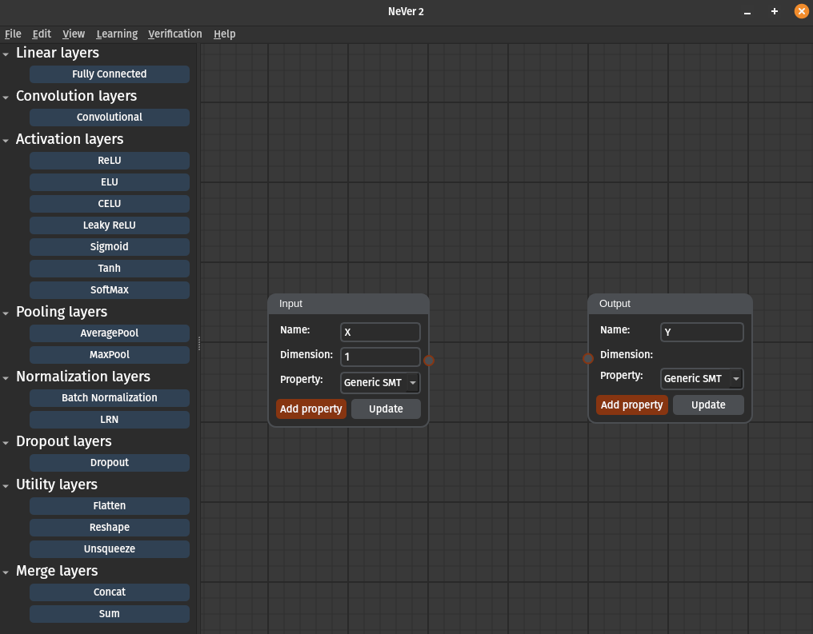
</p>

---

## Layer Palette and Supported Layer Types

The layer palette includes:

* Linear
* Convolutional
* Activation
* Pooling
* Normalization
* Dropout
* Utility
* **Merge layers**

The **Merge layers** group enables **branched (acyclic) architectures**.

---

## Building a Network Graphically

### Adding Layers

1. Select a block in the scene
2. Click a layer in the palette

<p align="center">
  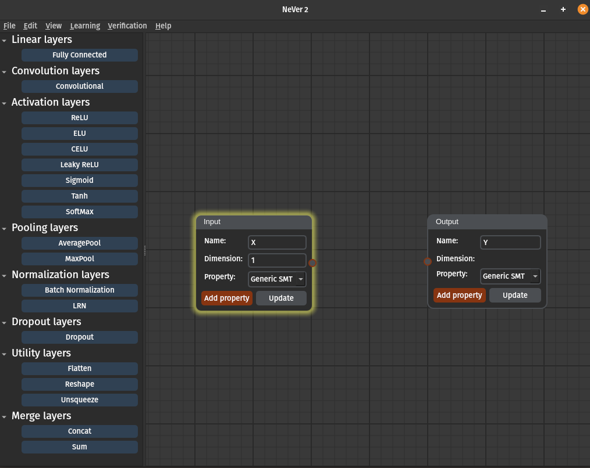
  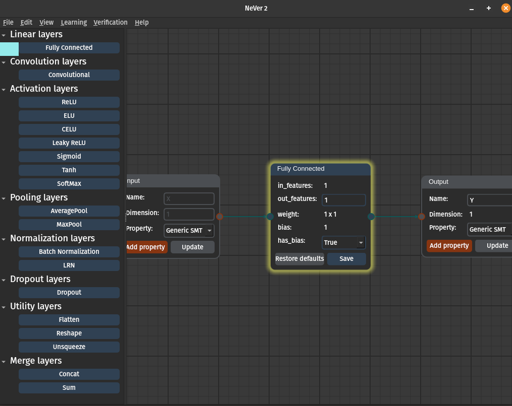
  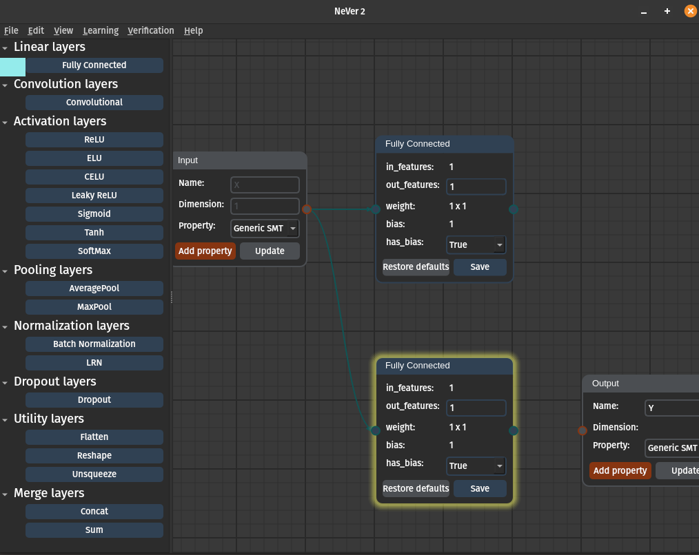
</p>

---

### Selecting Multiple Blocks

Blocks can be selected using:

* `Ctrl + Click`
* selection rectangle

<p align="center">
  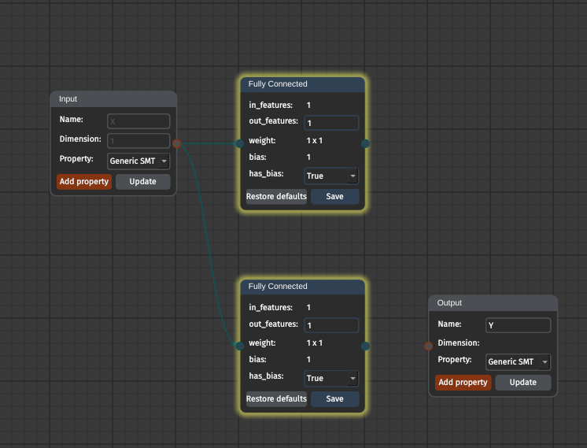
</p>

---

## Closing Branches with Merge Layers

To close branches:

1. Select all terminal blocks
2. Add a merge layer (`Concat`, `Sum`, …)

<p align="center">
  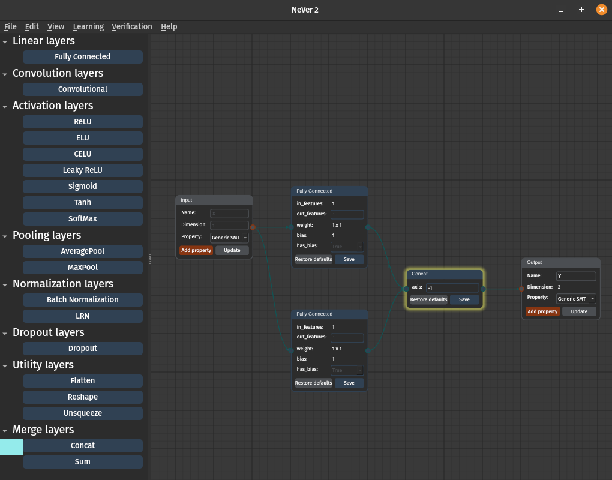
</p>

---

## Removing Layers

Blocks can be deleted with the `Delete` key.

Rules:

* blocks with children cannot be removed alone
* parents and children can be removed together

<p align="center">
  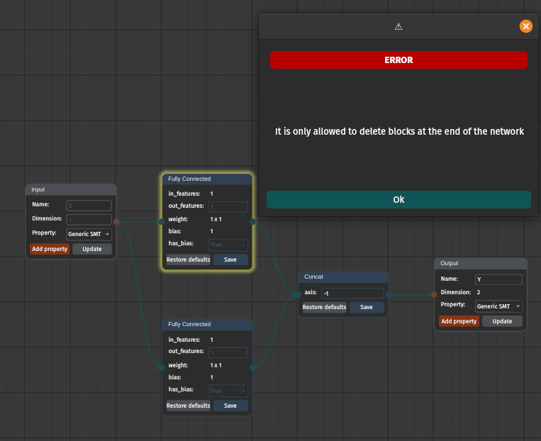
</p>

<p align="center">
  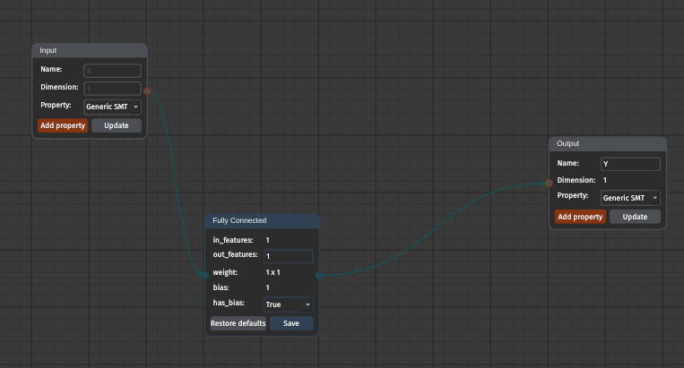
</p>

---

## Network Validation and Limitations

* Output block must be connected
* Only one input and one output are allowed
* **Learning** and **Verification** work only for sequential networks

<p align="center">
  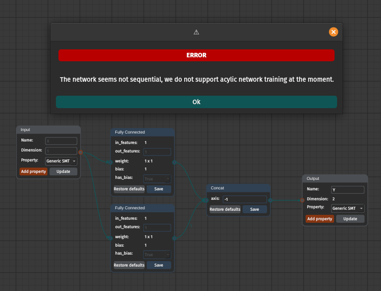
</p>

---

## Exporting Networks

```
File → Save As
```

Formats:

* **ONNX**
* **PyTorch**

Tracing is required for PyTorch export.

<p align="center">
  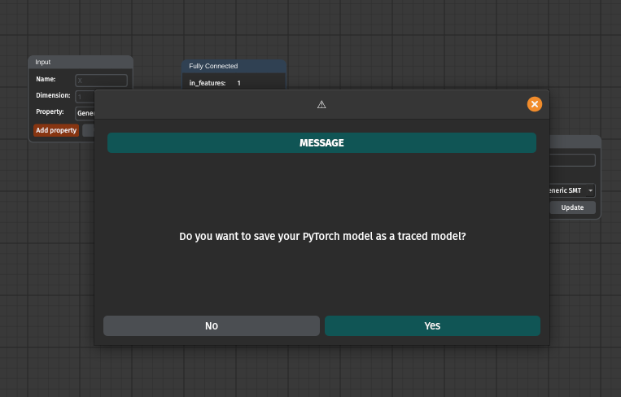
</p>

---

## Importing Networks

```
File → Open
```

* ONNX: direct import
* PyTorch: traced models only, input dimensions required

<p align="center">
  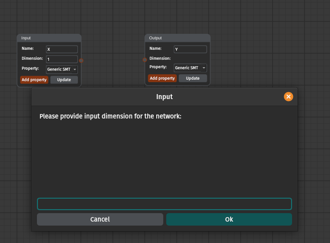
</p>

---
