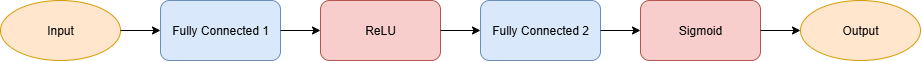
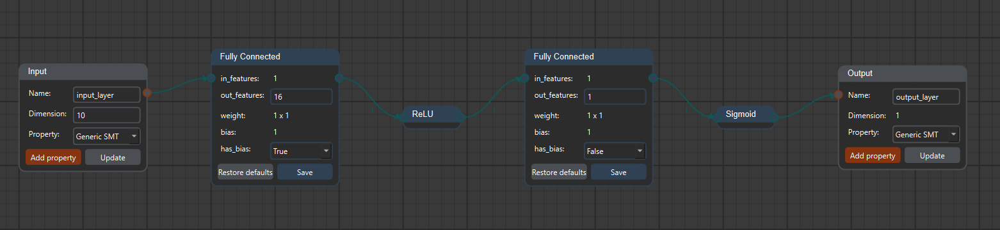
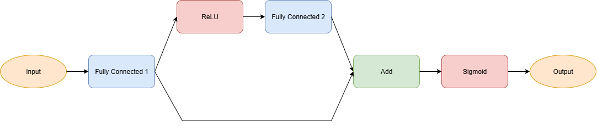

### User Requirements Specification Document
##### DIBRIS – Università di Genova. Scuola Politecnica, Software Engineering Course 80154

**VERSION : 4.0**

**Authors**  
Andrea Valentino Ricotti 
Azzurra Suffia 
Remi Gondoub Waoga Zongo

**REVISION HISTORY**

| Version    | Date        | Authors      | Notes        |
| ----------- | ----------- | :-----------: | ----------- |
| 1.0 | 2025-06-17 | Andrea Valentino Ricotti Azzurra Suffia Remi Gondoub Waoga Zongo | Initial requirements outline |
| 2.0 | 2025-07-06 | Andrea Valentino Ricotti Azzurra Suffia | Revised functional and non-functional requirements |
| 3.0 | 2025-08-25 | Andrea Valentino Ricotti Azzurra Suffia | Refined and updated functional requirements |
| 4.0 | 2025-09-18 | Andrea Valentino Ricotti Azzurra Suffia | Clarified functional requirement 7.0 timing (insertion request vs. insertion) |

# Table of Contents

1. [Introduction](#p1)
	1. [Document Scope](#sp1.1)
	2. [Definitios and Acronym](#sp1.2) 
	3. [References](#sp1.3)
2. [System Description](#p2)
	1. [Context and Motivation](#sp2.1)
	2. [Project Objectives](#sp2.2)
3. [Requirement](#p3)
 	1. [Stakeholders](#sp3.1)
 	2. [Functional Requirements](#sp3.2)
 	3. [Non-Functional Requirements](#sp3.3)

## 1. Introduction

This document is based on the initial interview with the Artificial Intelligence Laboratory of the University of Genoa. It outlines the extended functionalities of:

- <a href="https://github.com/NeVerTools/pyNeVer">pyNeVer</a>, a Python library for learning and verification of neural networks and other machine learning models.  
- <a href="https://github.com/NeVerTools/NeVer2">NeVer2</a>, a desktop application providing a GUI-based tool built on PyNever.

The document first defines its scope and explains relevant acronyms and external references. It then describes the system and the client-requested improvements. The final section presents the agreed-upon functional requirements.

### 1.1 Document Scope

The purpose of this document is to clearly and accurately capture the customer's needs and requirements in a form that is understandable to both technical and non-technical users. It also serves as a record to track changes and updates over time. This document provides a high-level functional description of the capabilities that the library and application must support, focusing on tasks they cannot currently perform when it comes to specific neural network architectures.

### 1.2 Definitions and Acronym

| Acronym				| Definition | 
| ----------------------------------- | ----------- | 
| NN                                  | Neural Network |
| ResNet                              | Residual Network |
| FFNN                              | Feed-Forward Neural Network |
| ReLU                              | Rectified Linear Unit |
| ELU                              | Exponential Linear Unit |
| LeakyReLU                              | Leaky Rectified Linear Unit |
| CELU                              | Continuously Differentiable Exponential Linear Unit |
| FC                              | Fully Connected |
| Conv                              | Convolutional |
| LRN                              | Local Response Normalization |

### 1.3 References 

<ul>
  <li><a href="https://github.com/NeVerTools/pyNeVer">pyNeVer</a></li>
  <li><a href="https://github.com/NeVerTools/NeVer2">NeVer2</a></li>
</ul>

## 2. System Description

Neural networks Verifier (<a href="https://github.com/NeVerTools/NeVer2">NeVer2</a>) is an open-source, cross-platform tool for the design, training and verification of neural networks, which seamlessly integrates popular learning libraries with the verification backend, offering their functionalities via a graphical interface. <a href="https://github.com/NeVerTools/pyNeVer">pyNeVer</a> is the corresponding Python package providing all the main capabilities of NeVer2.    
A Neural Network (NN) is a computational model, structured in multiple layers, where each layer contains units called neurons. Each neuron in a layer is connected to neurons in the next layer through weighted connections, allowing the network to pass and transform information from the input toward the output. These connections are what the network learns and adjusts during training to capture patterns in the data.  
A Feed-forward Neural Network (FFNN) is the simplest type of NN, where information flows only forward from the input to the output without cycles.

  

The image shows a basic FFNN: the Input layer receives the data, the first Fully Connected (FC) layer transforms it, followed by a ReLU activation that applies a non-linear transformation to the FC output. The second FC layer further processes the information, and finally, a Sigmoid activation produces the Output. 
Currently, NeVer2 supports only FFNNs. The picture above shows the network visualization in NeVer2.  
  

  

  
Users can specify the structure of a neural network in NeVer2 by intuitively arranging blocks on a canvas or by importing an existing FFNN from <code>.onnx</code> or <code>.pt</code> file formats. Subsequently, network training involves specifying dataset sources and hyperparameters through dialog boxes.  
After training, the verification process entails two steps:
<ol type="i">
  <li>incorporating input preconditions and output postconditions via dedicated blocks, and</li>
  <li>initiating verification with a simple <i>push-button</i> action.</li>
</ol>
Once the network is configured, users can export the FFNN in <code>.onnx</code> or <code>.pt</code> format as needed.   

The system accepts as input and allows the management of FFNNs composed only of activation functions and layers included in the following table:

  <table border="1" cellpadding="5" cellspacing="0">
    <tr>
      <td>ReLU</td>
      <td>ELU</td>
      <td>LeakyReLU</td>
      <td>CELU</td>
    </tr>
    <tr>
      <td>Sigmoid</td>
      <td>Tanh</td>
      <td>Fully Connected</td>
      <td>Batch Norm</td>
    </tr>
    <tr>
      <td>Conv</td>
      <td>AveragePool</td>
      <td>MaxPool</td>
      <td>LRN</td>
    </tr>
    <tr>
      <td>Unsqueeze</td>
      <td>Reshape</td>
      <td>Flatten</td>
      <td>Dropout</td>
    </tr>
  </table>

### 2.1 Context and Motivation

As discussed in the system description, the tool already allows to design and import FF models in the ONNX and PyTorch file formats, but lacks an interface towards ResNet models. Residual neural networks are a class of neural networks where the output of a layer can be forwarded to multiple deeper layers, through the so-called <i>skip connections</i>, allowing the network to pass information from earlier layers directly to later layers and extending the performances with respect to FF models. 
In fact, including ResNets in addition to FFNNs enhances the system’s capabilities by supporting more complex architectures that can achieve higher accuracy on challenging tasks, such as image classification, object detection, and semantic segmentation, while still allowing intuitive management of the network’s structure.  
In figure a visual example of a simple ResNet can be found.

  

### 2.2 Project Obectives 

The project aims to design and integrate ResNet representation and management into the NeVer2 tool. 
In particular, the objectives are:
<ol type="i">
	<li> to enable the system to import and export ResNet ONNX and PyTorch models for their verification and,</li>
	<li> to extend the graphical interface designer to include the visualization and construction of such models. </li>
 </ol>
Currently, the GUI displays a blank canvas showing only the input and output layers. Users can add layers and activation functions only sequentially, by clicking the corresponding buttons on the right side of the GUI, which generates a strictly linear sequence where each layer has only one successor and one predecessor. Consequently, to add a layer to the network in Never2, it can be placed only as successor of the last added node. To support ResNets, this behavior must be changed, allowing layers to have multiple parents and children. To be precise, any layer shall be able to support multiple children, but only two specific layers (<code>Add</code> and <code>Concat</code>) shall accept more than a single parent because of their structural properties. Moreover, for usability purposes, users should be able to add layers to specific nodes, not necessarily to the last one in the sequence.  Moreover, regarding removal, only the last layer can be deleted, forcing the user to remove one layer at a time starting from the bottom. This ensures that the structural properties of a FFNN are preserved — for example, preventing layers from having multiple predecessors or forming cycles, which would violate FFNN constraints. The same reasoning applies to adding layers, which is why sequential insertion is forced. However, such measure is restrictive. Our goal is to allow users to delete multiple layers at once, while still enforcing such structural constraints. 
Imported neural network files may represent fully connected layers in two ways: as a single layer or as two separate layers — a multiplication layer followed by an addition layer. To avoid confusion, the system shall always display and export fully connected layers as single layers.

 
### 3. Requirements
This section describes the application’s user-side functional requirements, assigning each one an ID and a priority according to the table below.

| Priority | Meaning | 
| --------------- | ----------- | 
| M | **Mandatory:**   |
| D | **Desiderable:** |
| O | **Optional:**    |
| E | **future Enhancement:** |

### 3.1 Stakeholders
In this subsection, we describe the groups of people interested in the application, and for each group we also explain why they are interested and how they intend to use the application.  
<ul>
	<li>Internal stakeholders</li>
	<ul>
		<li>Members of the Artificial Intelligence laboratory of the University of Genoa – to further improve, validate, and optimize the tool’s functionalities. </li>
	</ul>
	<li>External stakeholders</li>
	<ul>
		<li>Students – to practice designing, training, and verifying neural networks in a hands-on, interactive environment. </li>
		<li>Researchers – to test and validate new neural network models or verification techniques efficiently on different architectures. </li>
		<li>University supervisors – to monitor student projects and guide research work by reviewing network designs and verification results. </li>
		<li>Collaborating institutions or industry partners – to enable research collaboration, technology transfer, and potential application of the tool in real-world projects.</li>
		<li>Open-source contributors – to access the codebase, experiment with the tool, report issues, and extend its functionalities through new features or improvements.</li>  
		<li>Casual users – to download, run, and use the application for personal, educational, or exploratory purposes.</li>
	</ul>
</ul>

### 3.2 Functional Requirements 

| ID   | Description                                                                                							  		     | Priority |
|------|------------------------------------------------------------------------------------------------------------------------------------------------------------------|----------|
| 1.0  | The system shall allow the user to load a ResNet from a `.onnx` file on the local hard drive.										  | M        |
| 2.0  | The system shall allow the user to load a ResNet from a `.pt` file on the local hard drive.										  | M        |
| 3.0  | The system shall allow the user to save the ResNet as an `.onnx` file to a location of their choice on their local file system.	  | M        |
| 4.0  | The system shall allow the user to save the ResNet as a `.pt` file to a location of their choice on their local file system.  		  | M        |
| 5.0  | The system shall allow the user to feed a layer’s output into multiple subsequent layers.                                 			  | M        |
| 6.0  | The system shall allow the user to create `Add` and `Concat` as the only layers capable of receiving inputs from multiple preceding layers.                        | M        |
| 7.0  | The system shall allow the user to add a new layer only to an existing layer that, at the time the insertion request is made, has no successors. 	  	  | D        |
| 8.0  | The system shall display and export fully connected layers as single layers.														   	  | D        |
| 9.0  | The system shall allow the user to delete multiple layers at once, while ensuring that the network’s structural rules are maintained.    | O        |

### 3.3 Non-Functional Requirements 

| ID   | Description                                                                                							 		  | Priority |
|------|----------------------------------------------------------------------------------------------------------------------------------|----------|

